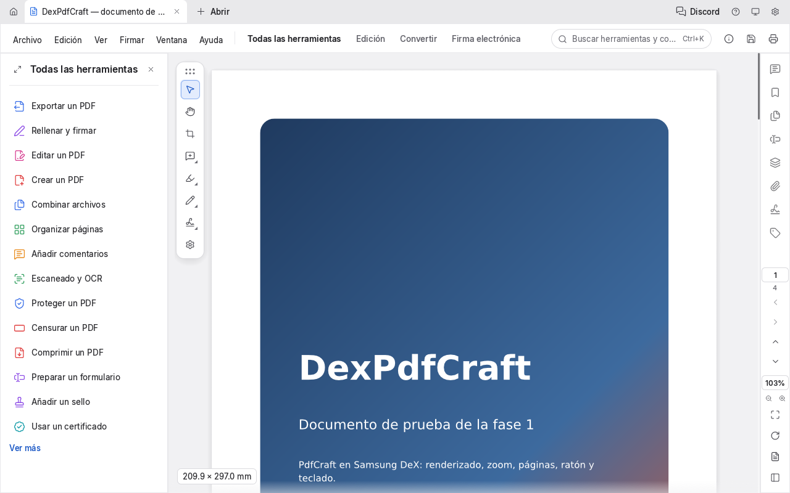

# Fase 2: la interfaz de PdfCraft en Android

La app ya no abre la ventana de prueba: arranca **la interfaz de escritorio de PdfCraft**
(`pdfcraft_ui_egui::PdfCraftApp`), con la misma disposición y los mismos comandos que en escritorio.
La ventana de diagnóstico de la fase 1 sigue disponible con la feature `probe`.

## Qué se ha hecho

### En el fork de PdfCraft (rama `dexpdfcraft/android`, [fork.md](fork.md))

| Parche | Contenido |
|---|---|
| 0001 | Shims de `rfd` y `arboard` (`android/rfd-shim`, `android/arboard-shim`). En los demás sistemas reexportan las crates reales, así que allí no cambia nada. En Android implementan la parte de la API que usa la interfaz y los responde un backend que instala la app. Sin backend, los diálogos de archivo se cancelan y el portapapeles funciona solo dentro de la app. Además se quitan los logotipos de ArtCraft, que las versiones modificadas deben eliminar. |
| 0002 | Las fuentes de reserva de la interfaz se buscan también en `/system/fonts`, donde Android guarda las suyas (no tiene fontconfig). |

### En la app (`apps/dexpdfcraft`)

- `src/pdfcraft.rs` arranca `PdfCraftApp` como lo hace la app de escritorio: ajustes, almacén de
  recuperación y diccionario del OCR. Se deja fuera lo que no tiene sentido en Android: instancia
  única, canal de control, eventos de Apple, impresoras del sistema y buscar actualizaciones.
- `android_main` apunta `HOME` y las carpetas XDG al almacenamiento privado de la app. Así el
  autoguardado, la recuperación tras un cierre y los ajustes funcionan sin tocar PdfCraft.
- `LANG` se toma del idioma del sistema (`es_ES.UTF-8`), que es lo que lee el idioma «Auto» de
  PdfCraft.
- Las traducciones (craft-i18n, en la revisión que fija upstream) se descargan con
  `scripts/fetch-build-inputs.sh`. Gradle las pasa a cargo y el CI las exige.
- En el primer arranque se abre el PDF de muestra.

## Verificado aquí (sin dispositivo)

- La librería compila para `aarch64-linux-android`. El APK de depuración (arm64) pesa unos 82 MB, de
  los que 57 MB son la librería: el motor completo, la interfaz y las fuentes incrustadas.
  Reducirlo queda para la fase 7.
- El binario de escritorio de DexPdfCraft muestra la interfaz completa de PdfCraft (capturas en
  `images/`), en inglés y en español.
- Tests: `posix_locale` (app) y los 25 de `system_fonts` del fork, incluido el nuevo de `/system/fonts`.

## Pendiente

- **Probar en DeX** (no hay dispositivo en este entorno). Lo más importante es comprobar que la
  interfaz arranca, que la escala es razonable en un monitor externo y que no hay cierres al
  redimensionar.
- **Fase 3**: hasta que existan los backends de Android, **Abrir y Guardar como se cancelan** y el
  portapapeles no sale de la app. Por ahora el único documento que se puede abrir es la muestra,
  y no tiene ruta en disco, así que guardarla también pide «Guardar como».
- Comprobar en un dispositivo qué fuentes de `/system/fonts` encuentra (árabe, CJK, coreano).
